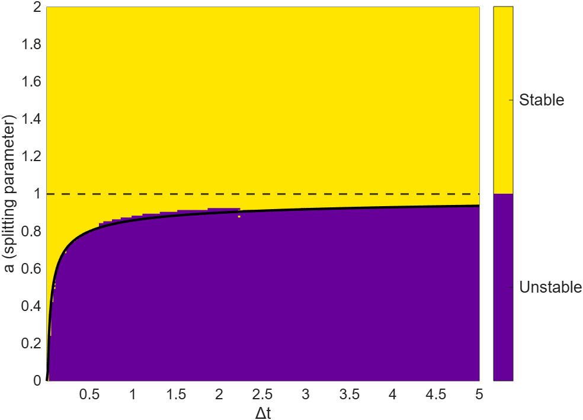
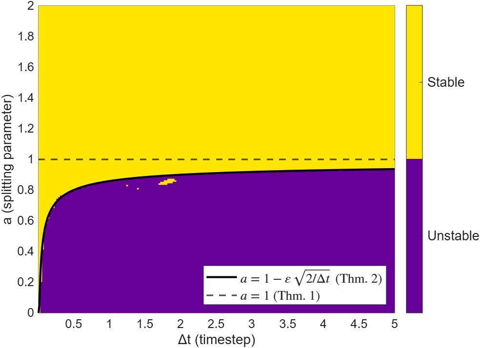
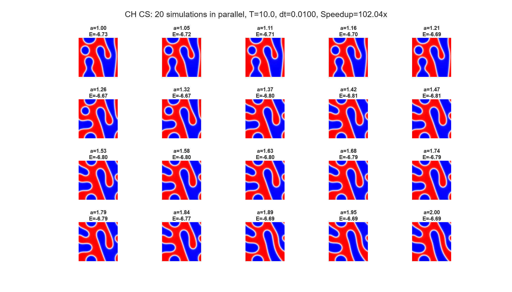
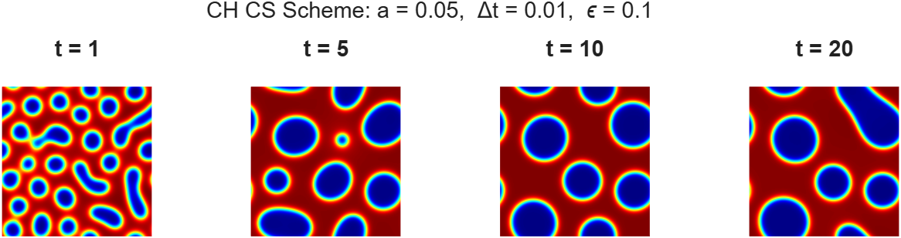
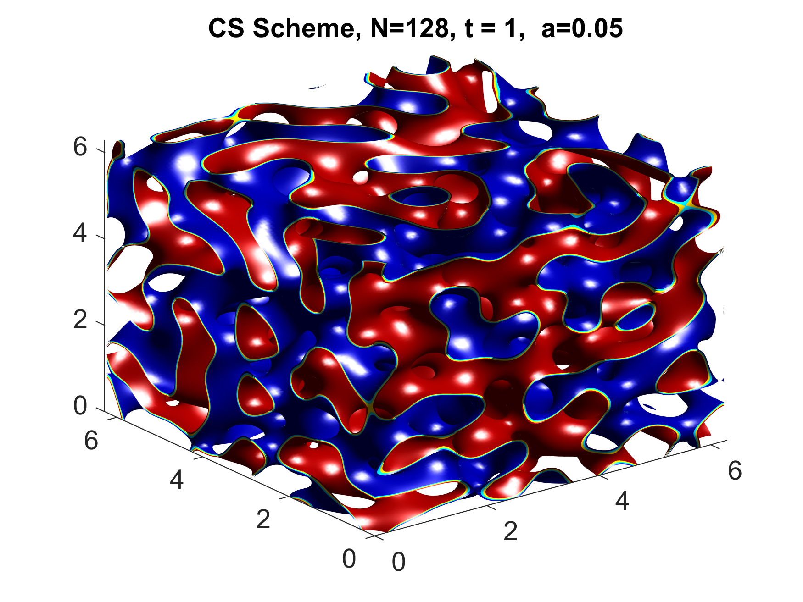
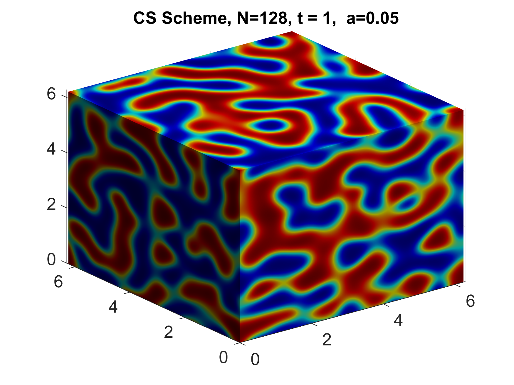
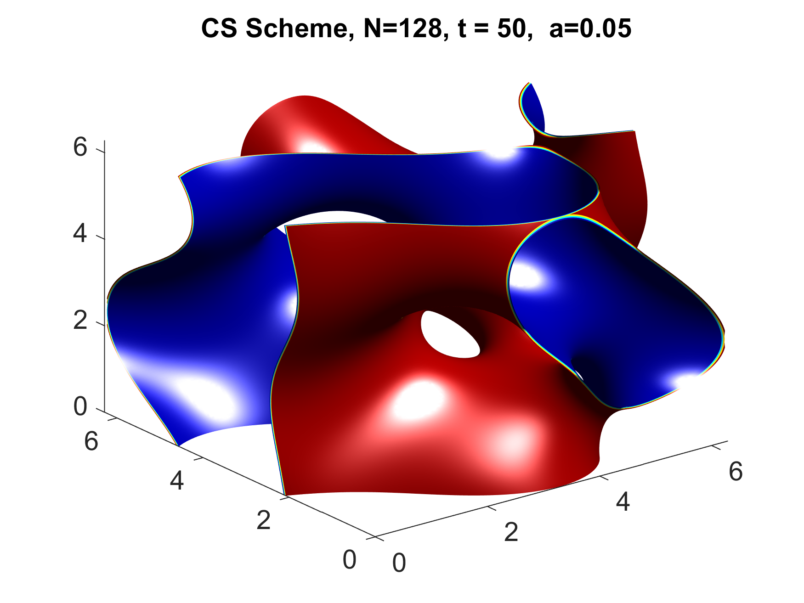
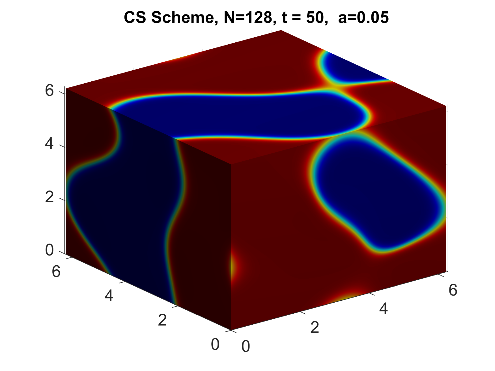

# CS_StabilityGPU
GPU Stability Maps and Energy Stability Analysis for the Cahn–Hilliard Convex Splitting Scheme

## Overview
MATLAB codes for the paper *GPU Stability Maps and Energy Stability Analysis for the
Cahn–Hilliard Convex Splitting Scheme* (S. Orizaga and S. Owusu, submitted to the
Journal of Computational Science).

The convex splitting (CS) scheme for the Cahn–Hilliard equation is advanced with a Fourier
spectral method on the periodic domain [0, 2π]^d. The stability map advances 40,000
independent simulations simultaneously on a single GPU, one for each pair (a, Δt), and
classifies each run by the stepwise energy law E_h(U^{n+1}) ≤ E_h(U^n). The computed
boundary is compared with the sufficient condition a ≥ 1 − ε√(2/Δt).

## Requirements
- MATLAB (tested with R2026a) with the Parallel Computing Toolbox
- NVIDIA CUDA-capable GPU. All computations are in double precision.

## Contents
- `ch_cs_stability_map_JOCS.m` — Stability map: 40,000 simultaneous CS simulations on the GPU, stepwise energy classifier, energy routine, mass and amplitude diagnostics
- `CH_20.m` — 20 simultaneous CS simulations with a in [1, 2] (N = 256)
- `CH_2D_JOCS.m` — 2D validation run with energy, max|U|, stepwise energy change, and mass drift
- `CH_3D_JOCS.m` — 3D validation run (N = 256^3) with the same diagnostics
- `CH_2D_JOCS_Errors.m` — Accuracy study: error versus Δt for several values of a, verified reference, energy-identity residual
- `CH2D_reference.mat` — Prepared state of the accuracy test: initial condition `U0`, reference solution `Uref` at t = 1, and its energy

## Random data and seeds
All random initial data use the default MATLAB generator (Mersenne Twister) with a fixed seed
set by `rng(seed)`. The stability map uses `seed = 42`; the seed-sensitivity study repeats a
subset with seeds 1, 2, 3, and 42. The accuracy study uses `rng(42)`.

## Usage
```matlab
% Stability map (paper settings): N = 64, eps = 0.1, 1000 steps,
% 200 values of a in [0, 2] and 200 values of dt in [0.01, 5]
run ch_cs_stability_map_JOCS.m

% 20 simultaneous simulations: a in [1, 2], dt = 0.01, N = 256
run CH_20.m

% 2D validation: a = 0.05, dt = 0.01 (or a = 0.7, dt = 0.5), eps = 0.1, N = 256
run CH_2D_JOCS.m

% 3D validation: a = 0.05, dt = 0.01 (or a = 0.7, dt = 0.5), eps = 0.1, N = 256^3
run CH_3D_JOCS.m

% Accuracy study: set RUN_REFERENCE = false to load CH2D_reference.mat
run CH_2D_JOCS_Errors.m
```

## Output
Running `ch_cs_stability_map_JOCS.m` generates the stability map (N = 64 left, N = 128 right):

 

Running `CH_20.m` generates the 20 simultaneous simulations:



Running `CH_2D_JOCS.m` generates the 2D validation run:



Running `CH_3D_JOCS.m` generates the 3D validation run (N = 256^3, a = 0.05):

 

 

## Performance
On an NVIDIA RTX PRO 6000 Blackwell Max-Q Workstation Edition GPU (96 GB), the full map of
40,000 runs (N = 64, 1000 steps, energy evaluated at every step) takes 94.6 seconds. A single
run of the same update on the CPU of the host (Intel Core i9-10885H) takes 0.262 seconds, so the
sequential CPU computation would take about 2.9 hours, a speedup of about 110×.
On the finer grid N = 128, the full map of 40,000 runs with 1500 steps takes about 1161 seconds
(19 minutes) on the same GPU, with a peak device memory of about 70 GB; the full batch fits on
the device without splitting.

## Citation
If you use this code, please cite:

S. Orizaga and S. Owusu, *GPU Stability Maps and Energy Stability Analysis for the
Cahn–Hilliard Convex Splitting Scheme*, submitted to the Journal of Computational Science (2026).


## Historical Note
The idea of systematic parameter space exploration was first attempted in
Orizaga & Witelski (2024), for thin-film equations and Cahn–Hilliard equations
with variable mobility using biharmonic-modified (BHM) IMEX schemes, where
stability plots over (a, Δt) grids required days of sequential computation
even for coarse, under-resolved parameter grids.
The present work resolves this bottleneck entirely: leveraging
GPU parallelism, the full 200×200 parameter sweep completes in
94.6 seconds on a single NVIDIA RTX PRO 6000 Blackwell — a ~110× speedup —
making systematic stability analysis of this scale routinely
accessible for the first time.

## Contact
We welcome questions, feedback, and potential collaboration opportunities—feel free to reach out! <br>

**Saulo Orizaga** — saulo.orizaga@nmt.edu  <br>
Associate Professor of Mathematics          <br>
New Mexico Institute of Mining and Technology  <br>
Socorro, NM 87801, USA.
